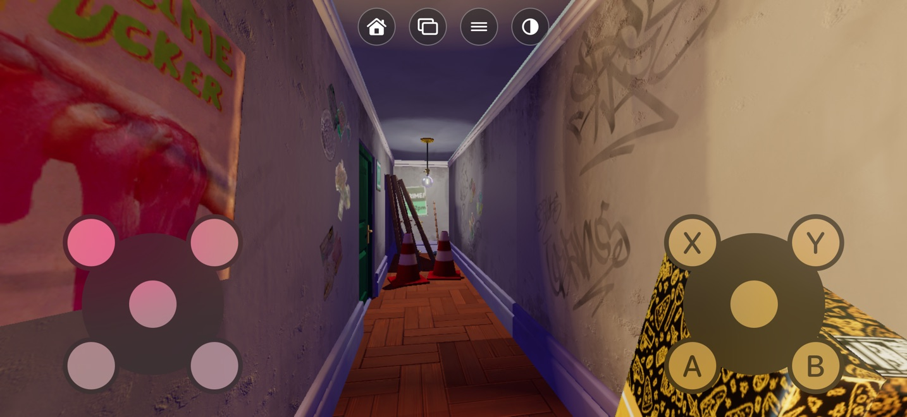

# On-screen controller: a working prototype



A touch controller for players without a pad ([issue #5](https://github.com/playportdev/playport/issues/5)).
It is a small library loaded into a released Playport. It shows how little the app needs, and the
same parts can move into `HostIO` (below). Tested on an iPhone 17 Pro Max with iOS 27.0.1 in
Anger Foot: playing with the touch pad, Start for the game's pause, Home and then Quit game, and
the opacity steps.

## What it does

- **The pad is the system's own.** `GCVirtualController` (GameController, iOS 15+) draws two
  thumbsticks, A/B/X/Y, LB/RB and LT/RT, and appears to the app as an ordinary `GCController`
  with an `extendedGamepad`. `HostIO.attach` hands it to the game as XInput slot 0, like any pad,
  so nothing in the runtime changes. The system refuses Menu and Options ("The configuration
  contains 2 elements that are not supported by the Apple touch controller"), and it has no Home.
- **It hides when a real pad is there.** It is shown while no physical pad is connected. When
  one connects, the touch pad disconnects; when the pad goes, the touch pad is back.
- **Its own row of buttons at the top centre:**
  - **Home** opens Playport's in-game menu (`InGameMenu.shared.open()`, as Home held does), with
    Resume and Quit game. While the menu is open, the touch pad is hidden and the menu's rows
    take taps.
  - **Back** and **Start** add `XINPUT_GAMEPAD_BACK` / `START` to the touch pad's state while
    held: the touch pad's current values plus the bit go through `host_pad_set(0, ...)`, every
    frame while held, because `HostIO` rewrites the slot whenever the touch pad changes.
  - **Opacity** steps the touch pad and the buttons through 100 → 75 → 50 → 30 %. The touch pad
    is the system's `GCControllerView`, found in the window tree and given an `alpha`. The choice
    is kept in `NSUserDefaults`.
  - **Opacity held** (0.6 s) turns the touch pad off, all of it: it disconnects, so its overlay and
    its touch areas go. Home, Back and Start hide, and only this button stays, now showing a pad.
    Held again, everything is back. This choice is kept too.

Games that read pads only as XInput work with this alone. Games that find pads through the raw
input HID list or through Windows.Gaming.Input (Unity's raw input, Rewired; Anger Foot is one)
also need [#53](https://github.com/playportdev/playport/pull/53), as with a physical pad.

## How the prototype is loaded

It needs nothing from the app but what its executable already exports:

- `host_pad_set`;
- `$s8Playport10InGameMenuC6sharedACvau`, the addressor of `InGameMenu.shared`;
- `InGameMenu.open()` and `.isOpen`, called with clang's `swiftcall` and the object as
  `swift_context`, which is `self` in x20.

To build and load it:

```sh
xcrun -sdk iphoneos clang -arch arm64 -mios-version-min=26.0 -dynamiclib -fobjc-arc \
    -framework Foundation -framework UIKit -framework GameController -framework QuartzCore \
    -install_name @executable_path/Frameworks/PlayportTouchPad.dylib \
    -o PlayportTouchPad.dylib PlayportTouchPad.m
cp PlayportTouchPad.dylib Payload/Playport.app/Frameworks/
python3 add_dylib.py Payload/Playport.app/Playport @executable_path/Frameworks/PlayportTouchPad.dylib
```

`add_dylib.py` appends an `LC_LOAD_DYLIB` to the executable. The 0.4.0 executable has about
7 KB free after its load commands. Then the app is signed again, the library included. The
library logs to `Documents/playport-touchpad.log`.

## Moving it into the app

- **`HostIO`** owns a `GCVirtualController` and connects it while no physical extended gamepad
  is attached (the same `GCControllerDidConnect` / `DidDisconnect` observers). Its controller
  then goes through `attach` like any other.
- **Back and Start** are better as part of the slot's `PadValues`, OR-ed in before
  `GuestPadGate`, than as a second writer of `host_pad_set`. The gate then holds them while the
  menu is up.
- **Home** calls `InGameMenu.shared.open()` directly. Showing it only while a game runs
  (`TitleLaunch.acceptsMenu`) avoids a dead button on Playport's own screens.
- **Opacity**, and the touch pad's on/off, belong in Settings. Playport's own screens might also
  prefer the touch pad off, since they take taps.
